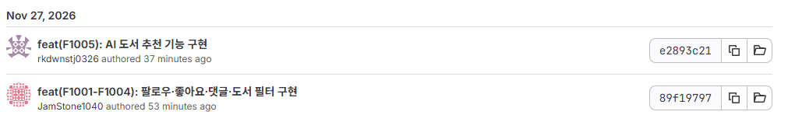

# ThRead · 도서 탐색과 독서 기록

ThRead는 **읽을 책을 찾고, 읽은 책에 대한 기록을 나누는** 도서 커뮤니티입니다. 장르별로 책을 둘러보고, 관심 있는 책의 상세 페이지에서 연관 도서를 추천받을 수 있습니다. 로그인하면 책에 대한 독서 기록을 쓰레드로 남기고, 다른 독자의 글에 좋아요와 댓글을 남기거나 작성자를 팔로우할 수 있습니다.

**사용 기술** · Python 3.11, Django 5.2, SQLite, Bootstrap 5, Axios, SSAFY GMS

## 빠른 시작

Python 3.11을 설치한 뒤, `manage.py`가 있는 프로젝트 폴더에서 아래 명령을 실행합니다. Windows PowerShell 기준입니다.

```powershell
py -3.11 -m venv .venv
.\.venv\Scripts\python.exe -m pip install -r requirements.txt
.\.venv\Scripts\python.exe manage.py migrate
.\.venv\Scripts\python.exe manage.py loaddata categories books
.\.venv\Scripts\python.exe manage.py runserver
```

초기 데이터를 불러오면 7개 분류의 도서 947권이 준비됩니다. 브라우저에서 [도서 목록](http://127.0.0.1:8000/books/)을 엽니다.

## 이렇게 사용합니다

1. **책 찾기** · 도서 목록에서 분류를 선택하고, 관심 있는 책의 상세 페이지를 엽니다. 목록과 상세 정보는 로그인 없이 볼 수 있습니다.
2. **다음 책 고르기** · 상세 화면에서 **추천 받기**를 누르면 연관 도서가 최대 3권 나타납니다. GMS 키 없이 실행해도 저장된 도서 정보를 바탕으로 추천합니다.
3. **독서 기록 나누기** · [회원가입](http://127.0.0.1:8000/accounts/signup/) 후 도서 상세에서 **쓰레드 작성**을 선택합니다. 쓰레드 상세에서 좋아요와 댓글을 남길 수 있고, 댓글은 작성자 본인이 삭제할 수 있습니다.
4. **작성자 팔로우하기** · 쓰레드에서 작성자 이름을 눌러 프로필로 이동한 뒤 **팔로우**를 누릅니다. 팔로우 상태와 숫자는 해당 화면에서 바로 바뀝니다.

## 주요 기능과 실행 결과

Chrome에서 각 기능을 실행하고, 요청 결과가 새로고침 없이 화면에 반영되는 것을 확인했습니다.

| 요구사항 | 주요 기능 | 실행 화면 |
| --- | --- | --- |
| F1001 | 다른 사용자를 팔로우하거나 취소하고 팔로워·팔로잉 수를 갱신합니다. | [팔로우 적용](screenshots/F1001-follow.png) |
| F1002 | 쓰레드에 좋아요를 누르거나 취소하고 좋아요 수를 갱신합니다. | [좋아요 적용](screenshots/F1002-thread-like.png) |
| F1003 | 쓰레드에 댓글을 작성하고 본인의 댓글을 삭제합니다. | [작성 후](screenshots/F1003-01-comment-created.png) · [삭제 후](screenshots/F1003-02-comment-deleted.png) |
| F1004 | 전체 도서를 표시하고, 로그인 없이 분류별로 필터링합니다. | [전체 도서](screenshots/F1004-01-all-books.png) · [경제/경영 선택 후](screenshots/F1004-02-category-filter.png) |
| F1005 | GMS를 활용해 현재 도서와 관련 있는 책을 최대 3권 추천합니다. | [실제 GMS 추천 결과](screenshots/F1005-ai-recommendations.png) |

## AI 추천 설정과 동작 방식

실제 AI 추천을 사용하려면 서버를 실행하기 전에 아래 명령으로 설정 파일을 만듭니다. 이미 `.env`가 있다면 그 파일을 사용합니다.

```powershell
Copy-Item .env.sample .env
```

`.env`의 `GMS_KEY`에 발급받은 키를 입력합니다. `GMS_URL`은 예제의 SSAFY GMS 주소를 사용합니다. 서버를 이미 실행 중이라면 설정 저장 후 다시 시작합니다. `.env`는 Git에서 제외됩니다.

추천은 아래 순서로 진행됩니다.

1. 상세 화면의 도서를 기준으로 나머지 도서의 제목과 소개에서 단어를 추출합니다. 단어의 포함 여부를 비교한 코사인 유사도에 같은 장르와 같은 저자에 대한 가점을 더해 상위 10권을 추립니다. 점수가 같으면 리뷰 평점과 도서 ID 순으로 정렬합니다.
2. GMS가 설정되어 있으면 `gpt-5-nano`에 기준 도서와 후보의 제목, 부제, 장르, 저자, 소개 앞부분을 전달합니다. 모델은 주제와 분위기를 비교해 관련도 순서대로 후보 ID를 반환합니다. 서버에서 후보에 실제로 존재하는 ID인지, 개수와 중복 여부가 올바른지 검증합니다.
3. 같은 입력의 AI 추천은 1시간 캐시합니다. GMS 설정이 없거나 호출이 실패하거나 응답 검증에 실패하면 1단계 순서대로 추천합니다. 실패한 호출은 1분간 다시 시도하지 않습니다.

## 추천 기능 테스트

```powershell
.\.venv\Scripts\python.exe manage.py test books
```

자동 테스트에서 추천 요청의 CSRF 보호, 유효한 AI 응답의 순서와 캐시, API 오류 시 대체 추천을 확인합니다.

## 역할 분담과 Git 규칙

- F1001~F1004는 필수 기능 담당자가, F1005는 심화 기능 담당자가 구현했습니다.
- `master`는 통합·제출용 브랜치입니다. 현재 두 기능 범위의 커밋이 모두 `master`에 있습니다.
- 이후 기능 작업은 `feature/<요구사항 번호>-<기능명>` 브랜치에서 진행하고, 검토 후 Merge Request로 `master`에 반영합니다.
- 커밋 메시지는 `종류(요구사항 번호): 작업 내용` 형식으로 작성합니다. 기능이 동작하는 시점에는 `feat`, 문서와 캡처를 정리한 시점에는 `docs`, 발견한 결함을 수정했을 때는 `fix`를 사용합니다.
- 실제 구현 커밋은 `feat(F1001-F1004): 팔로우·좋아요·댓글·도서 필터 구현`과 `feat(F1005): AI 도서 추천 기능 구현`입니다.

### GitLab 커밋 내역



## 학습 내용과 회고

- 팔로우와 좋아요는 다대다 관계로, 댓글은 쓰레드와 작성자를 참조하는 외래 키로 다뤘습니다.
- Axios 요청의 응답으로 필요한 화면 요소만 갱신했습니다. 댓글 삭제처럼 권한이 필요한 동작은 서버에서도 검사했습니다.
- 추천 결과가 정상적으로 표시되는 경우와 GMS에 연결할 수 없는 경우를 함께 검증하면서, 외부 API를 쓰는 기능에서는 실패했을 때의 화면도 설계해야 한다는 점을 배웠습니다.
